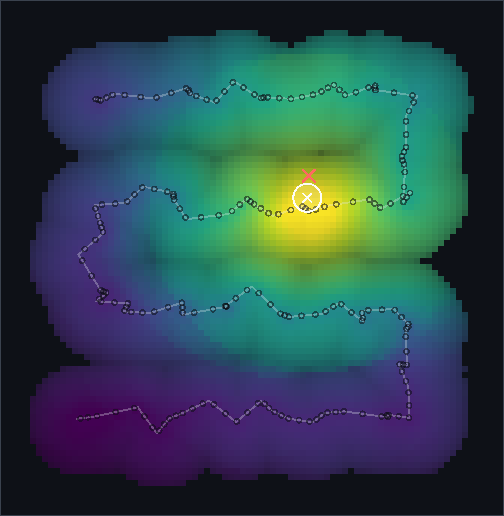
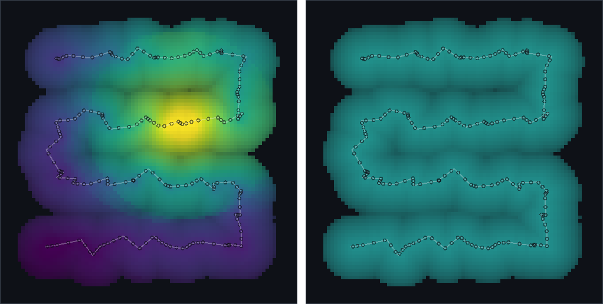

<div align="center">

# SpectraMap

**Map the radio-frequency environment across physical space.**

[](https://github.com/IotA-asce/spectramap/actions/workflows/ci.yml)
[](LICENSE)
[](pyproject.toml)
[](tests/)
[](#try-it-in-sixty-seconds)



<em>A survey walked around a 433.92 MHz beacon. Dots are real measurements; colour
between them is interpolated; dark gaps are ground no measurement came within 14 m of.
The white circle is the estimated strongest-signal region and its uncertainty; the
red ✕ is where the transmitter actually was — <strong>the mapping code was never
told</strong>.</em>

</div>

---

A traditional spectrum analyser answers *what frequencies exist here*. SpectraMap
answers a bigger question:

> What frequencies exist **where**, **when**, and with what **spatial structure**?

Carry an SDR receiver and a GPS source through an area. SpectraMap records power
spectra tied to position and time, stores them in an open, portable format, and
reconstructs the invisible radio landscape as a map you can explore by frequency.

The central object is not `Spectrum(frequency)` but:

```
RF(latitude, longitude, altitude, frequency, time)
```

SpectraMap is a **passive measurement instrument**. It receives, measures and maps. It
does not transmit, decode payloads, defeat access controls, or interfere with
communications — see [safety-and-legal.md](docs/safety-and-legal.md).

---

## Status

**V0 — the simulated vertical slice works end to end. No radio hardware required.**

```
virtual transmitter → MockSDR → synthetic IQ → DSP → spectrum observation
   → MockGPS route → geotagged observations → persistent survey
   → spatial aggregation → interpolation → RF heatmap
```

Every push, CI reconstructs a synthetic transmitter's region from a simulated walk
**without telling the mapping code where the transmitter is**, and asserts the answer
lands within metres of the truth. It also asserts that a spatially flat control signal
is *refused* rather than localised.

Physical RTL-SDR integration is the next milestone. The driver is written and the
abstraction is in place, but it has **not yet been validated against real hardware**.
See [v0-plan.md](docs/v0-plan.md) for milestone status and what remains unproven.

---

## Try it in sixty seconds

No SDR, no GPS, no network.

```bash
pip install -e '.[dev]'

spectramap devices                       # the simulator appears as a device
spectramap survey --driver mock \
    --frequency 433.92MHz --gain 24 \
    --duration 80 --name backyard-test \
    --output surveys/backyard-test.smap
spectramap analyze surveys/backyard-test.smap --frequency 433.92MHz
spectramap serve  surveys/backyard-test.smap
```

`analyze` prints a summary, writes a heatmap, and reports the probable
strongest-signal region — with the caveats that belong to it:

```
Analysis: backyard-test
  Observations used     147
  Unit                  dBFS/Hz (relative, uncalibrated)
  Measured range        -91.6 to -63.6 dB (span 28.0 dB)

Spatial reconstruction
  Algorithm             inverse distance weighting
  Coverage              100% of the raster is within 40 m of a measurement
                        the rest is masked, not drawn: nothing was measured there

Strongest-signal region  [ESTIMATED]
  Probable strongest-signal region near 0.00013, -24.99987
    (estimated radius 4 m, confidence: good)
  Geometry score        0.66
  - Estimated from received signal strength only. Multipath, obstructions and
    antenna orientation can move the apparent strongest region by tens of metres.
  - This marks where the signal was strongest, not where a transmitter is.
```

`serve` opens a local map with the route, the individual measurement points, an RF
intensity layer with a frequency selector, and a spectrum viewer for any point you
click.

Or run the whole slice as one script:

```bash
python examples/simulated_survey.py            # ~1.4 s for an 80-second survey
python examples/simulated_survey.py --scenario full
```

---

## Move the frequency selector, and the landscape changes

<div align="center">



<em>The same survey, two frequencies. <strong>Left, 433.92 MHz:</strong> a clear
gradient converging on the beacon. <strong>Right, 433.95 MHz:</strong> a distant
carrier — plainly detectable, but with no usable spatial structure. Both panels share
the same 23 dB colour range, so a colour step means the same number of decibels in
each. Autoscaling the right panel to its own 0.4 dB variation would have rendered noise
as a confident-looking gradient; SpectraMap instead grades that signal
<code>confidence: low</code> and states it is not usable as a location.</em>

</div>

---

## What it records

Every observation keeps the context needed to interpret it years later:

| | |
|---|---|
| **Where** | latitude, longitude, altitude, reported accuracy, and how the position was obtained (measured / interpolated / extrapolated) |
| **When** | UTC and host-monotonic timestamps for both the RF and the position timelines |
| **What** | the full power spectrum, its frequency axis, units, FFT size, window, and equivalent noise bandwidth |
| **How** | receiver, antenna, centre frequency, sample rate, gain, AGC state |
| **How well** | quality flags: `SDR_OVERLOAD`, `GPS_LOW_ACCURACY`, `DROPPED_SAMPLES`, `GAIN_CHANGED`, `AGC_ACTIVE`, … |

Poor measurements are **flagged, never deleted**. Filtering is an analysis decision, and
the analyst gets to make it.

---

## Design commitments

These are rules the code keeps and the tests enforce — not aspirations.

**Measurement and interpolation are different things.** Every value carries an
`Evidence` tag: `MEASURED`, `DERIVED`, `INTERPOLATED`, `ESTIMATED`, `ASSUMED`. The
heatmap is masked wherever the nearest real measurement is too far away, so the map has
holes exactly where the survey had holes. Interpolation confidence drives opacity. You
can always reveal the measurement points underneath.

**Uncalibrated numbers are labelled uncalibrated.** V0 produces relative `dBFS`/`dBFS/Hz`
referenced to receiver full scale, never bare `dBm`. A test asserts that no output of an
uncalibrated survey contains the string `dBm`. Calibration is a first-class concept with
a place in the architecture — and V0 has not done it.
See [calibration.md](docs/calibration.md).

**No false precision.** The strongest-signal estimator returns a *region* with a radius,
a confidence grade and explicit caveats — never a transmitter's coordinates. The radius
is floored by the survey's own position accuracy, because nothing can be located more
precisely than the receiver was. A geometry score tells you when your survey shape could
not constrain the answer.

**Fixed gain by default.** Under AGC the receiver quietly rescales itself as you walk,
and spatial power comparison stops meaning anything. SpectraMap defaults to fixed gain,
warns loudly if you don't, and flags every affected observation.

**Averaging happens in the linear power domain.** Averaging decibels computes a geometric
mean and under-reports exactly the bursty signals a user is hunting.

**Hardware is replaceable and CI needs none of it.** Everything above `spectramap.sdr`
talks to one `SDRDevice` interface. The full test suite runs with no radio attached.

---

## Architecture

A modular local application. No microservices, no cloud, no server database.

```
                Frontend  (map · spectrum explorer · surveys)
                    |
               Analysis API
       ------------------------------
       |            |               |
   Geospatial      DSP        Hotspot est.
       ------------------------------
                    |
               Survey Store  (.smap)
                    ^
             Acquisition Engine
                 /       \
             SDRDevice   PositionProvider
```

Python throughout: numpy for DSP, SQLite plus flat `float32` arrays for storage, and a
dependency-free browser front end. **Core install is two dependencies** (`numpy`,
`PyYAML`); drivers and exporters are extras, so CI and the entire simulated pipeline run
without a native stack.
See [ADR 0001](docs/adr/0001-implementation-language.md).

---

## The survey format

A survey is a self-contained, portable directory. Another developer can read the
measurements without running SpectraMap — and CI checks that claim on every push:

```
backyard-test.smap/
├── manifest.json        format version, full configuration, device, antenna, units
├── survey.sqlite        observation index, raw GPS track, event log
├── spectra/
│   └── chunk_000000.f32 flat little-endian float32, C order, (n_rows, n_bins)
├── route.geojson        survey path and measurement points
├── calibration/
└── processing/          derived products, each with a provenance record
```

```python
import json, numpy as np
manifest = json.load(open("backyard-test.smap/manifest.json"))
chunk = manifest["spectra"]["chunks"][0]
spectra = np.memmap("backyard-test.smap/" + chunk["path"],
                    dtype="<f4", mode="r").reshape(-1, chunk["n_bins"])
freqs = chunk["f_start_hz"] + np.arange(chunk["n_bins"]) * chunk["f_step_hz"]
```

Full schema: [survey-format.md](docs/survey-format.md).

---

## Documentation

| Document | What it covers |
|---|---|
| [architecture.md](docs/architecture.md) | System structure, data flow, time synchronisation |
| [v0-plan.md](docs/v0-plan.md) | Milestones, acceptance criteria, current status |
| [rf-measurement-model.md](docs/rf-measurement-model.md) | The observation model and what a measurement means |
| [dsp-pipeline.md](docs/dsp-pipeline.md) | FFT scaling, windows, ENBW, units — with the maths |
| [survey-format.md](docs/survey-format.md) | The open `.smap` format, field by field |
| [hardware-v0.md](docs/hardware-v0.md) | Receivers, GPS sources, antennas, what to buy |
| [calibration.md](docs/calibration.md) | Why V0 is uncalibrated and how to change that |
| [technical-risks.md](docs/technical-risks.md) | Everything that can make a measurement wrong |
| [safety-and-legal.md](docs/safety-and-legal.md) | Scope, ethics, and your responsibilities |
| [adr/](docs/adr/) | Six architecture decision records |

---

## Roadmap

| | |
|---|---|
| **V0** | **Spatial spectrum mapper** — SDR + GPS → measurements → heatmap |
| V1 | Wideband sequential sweeps |
| V2 | Temporal analysis and survey differencing ("RF time machine") |
| V3 | Probabilistic source-region localisation |
| V4 | Directional antennas and IMU orientation |
| V5 | Drone telemetry consumption |
| V6 | Volumetric `RF(x, y, z)` reconstruction |
| V7 | Link and interference analysis |
| V8 | Optional signal-pattern classification |

Explicitly **not** in V0: drone integration, 3D mapping, advanced localisation,
multi-receiver synchronisation, direction finding, any form of decoding or interception,
jamming, transmitter impersonation, AI classification, cloud services.

---

## Contributing

Contributions are welcome — most valuable right now is **physical hardware validation**.
See [CONTRIBUTING.md](CONTRIBUTING.md).

```bash
pytest              # 227 tests, no hardware needed
ruff check .
```

The engineering priorities, in order: measurement integrity, reproducibility, correct
DSP, raw-data preservation, transparent uncertainty, hardware abstraction, testability,
performance, visualisation, advanced features.

> Never prioritise a beautiful heatmap over correct measurements.

## License

MIT — see [LICENSE](LICENSE).
